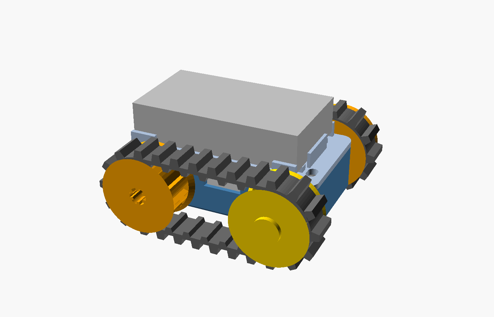
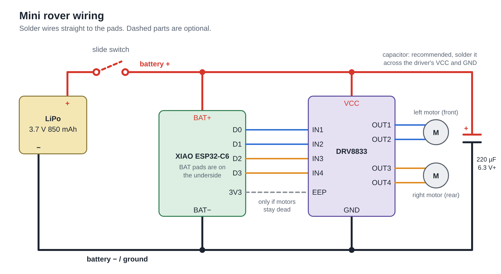

# Mini ESP32 rover

A palm-sized tracked rover (about 59 × 52 × 30 mm) driven from a phone over Wi-Fi.



| Part | Used here |
| --- | --- |
| Controller | Seeed Studio XIAO ESP32-C6 (C3 / S3 also work) |
| Motor driver | DRV8833 dual H-bridge breakout |
| Motors | 2 × micro DC gear motor with plastic gearbox |
| Battery | LiPo, 3.7 V 850 mAh, 45 × 25 × 10 mm, with a red two-pin plug |
| Printed | PETG chassis, deck, wheels, pins; TPU tracks |
| Hardware | 4 × M2 × 8 self-tapping screws, double-sided foam tape, a pigtail with the mating half of the battery plug |

> **Status:** work in progress. The motor pockets, sprocket hubs and tracks
> have been through one round of test prints; the stacked layout below has
> not been printed yet, and the firmware has not been compiled or run on
> hardware. Expect to tune.

## Layout

The two motors lie crosswise and staggered: the left track is driven at the
front, the right track at the rear, with a free-spinning idler at the other end
of each track. That keeps the body only a little wider than one motor is long.
Each motor is captured inside the tub and its sprocket reaches in through the
wall to meet it.

Between the motors the parts are stacked to keep the chassis short (48.6 mm):
the DRV8833 lies on the floor, the XIAO sits on shelves above it, and the
battery rides on top of the deck, open, between low rails. It is pushed
forward so that a hole in the deck behind it stays clear: the mating plug's two
leads come up through that hole and the battery plugs in above the deck.
The XIAO's USB-C socket faces out of the left
wall, so the cable plugs in from the side, through the window between the two
wheels and the track runs. That window is 14.5 mm wide: use a slim plug.

## Printing

Everything comes from one parametric file, [`cad/rover.scad`](cad/rover.scad).
Ready-made STLs are in [`cad/stl/`](cad/stl), each already oriented for printing.

| File | Qty | Material | Notes |
| --- | --- | --- | --- |
| `chassis.stl` | 1 | PETG | open side up, no supports |
| `deck.stl` | 1 | PETG | flat side down |
| `sprocket.stl` | 2 | PETG | as oriented (nose up), no supports |
| `idler.stl` | 2 | PETG | |
| `pin.stl` | 2 | PETG | head down |
| `track.stl` | 2 | TPU | a round ring standing on edge; 0.4 mm nozzle, 2 walls |
| `hubtest.stl` | 1 | PETG | fit test for the motor output, print this first |

**Measure your parts before printing.** With calipers, check the values in the
"Measure these on your parts" block at the top of `rover.scad` (motor can,
gearbox diameter and length, output pinion, board sizes), edit them, and
re-export:

```sh
cd cad
for p in chassis deck sprocket idler pin track hubtest; do
  openscad -D "part=\"$p\"" -o stl/$p.stl rover.scad
done
```

The motors end in a small pinion gear (6 teeth, 4.46 mm across the tips), so
the sprocket hub has a round bore with six keys that drop into the valleys
between the teeth (`gear_teeth`, `gear_od`, `gear_valley_w`). Print `hubtest`
first: three pucks with the socket 0.1 mm tighter, nominal, and 0.1 mm looser
(1, 2, 3 notches). Set `gear_fit` to match the one the pinion presses into
snugly. If your printer cannot resolve the keys, `gear_teeth = 0` gives a plain
undersized round bore to force the pinion into. For a plain D shaft set
`shaft_type = "d"`.

After that, good test prints are one `sprocket` and one `track` (tension). If the
track is loose or tight, change `track_slack`; if it
skips, raise `tooth_h`.

## Wiring



```
LiPo +  ──[optional slide switch]──┬── XIAO BAT+ (pad on the underside)
                                   └── DRV8833 VCC / VM
LiPo −  ───────────────────────────┬── XIAO BAT−
                                   └── DRV8833 GND

XIAO D0 ── IN1        OUT1, OUT2 ── left motor  (front)
XIAO D1 ── IN2
XIAO D2 ── IN3        OUT3, OUT4 ── right motor (rear)
XIAO D3 ── IN4
```

- Power the driver from the battery, not from the XIAO's 3V3 pin.
- `EEP` / `SLP` on the DRV8833 must be high for the outputs to work. Most
  breakouts pull it up already; if the motors are dead, wire it to XIAO `3V3`.
- A 100–470 µF capacitor across the driver's VCC and GND helps stop the ESP32
  resetting when the motors start.
- Optional: a 0.1 µF ceramic capacitor soldered across each motor's two
  terminals cuts electrical noise. No resistors are needed.
- With the battery on the BAT pads, the XIAO charges it over USB-C. Use a cell
  with a protection board (the XIAO has no low-voltage cut-off).
- Solder wires straight to the boards; there is no room for pin headers.

## Firmware

A [PlatformIO](https://platformio.org/) project in [`firmware/`](firmware).

```sh
cd firmware
pio run -t upload              # XIAO ESP32-C6 (default)
pio run -e xiao_c3 -t upload   # or xiao_s3
```

Then join the Wi-Fi network `mini-rover` (password `roverrover`) and open
<http://192.168.4.1/>. Drag the on-screen stick, or use WASD / arrow keys.

Settings live in [`firmware/src/config.h`](firmware/src/config.h):

- A track runs backwards → flip `LEFT_INVERT` / `RIGHT_INVERT`.
- Steering is mirrored → set `SWAP_SIDES`.
- Motors hum but do not move at low stick → raise `MIN_DUTY`.
- ESP32 resets when driving off → lower `RAMP_PER_TICK`, add the capacitor.

The rover stops by itself if it hears nothing from the phone for 400 ms.

## Assembly

1. Solder the wiring with the boards outside the chassis (motor leads about
   40 mm, battery leads left long) and bench test it.
2. Drop the motors into their pockets with the flats of the can vertical,
   between the two cheeks, and the pinion in the U-slot in the wall. The
   gearbox is trapped between the wall and the cheek ends, the cheeks stop the
   motor turning, and the deck holds it down.
3. Lay the DRV8833 on the floor of the middle bay (foam tape underneath).
4. Lower the XIAO onto its shelves above the driver, USB-C socket into the
   notch in the left wall and antenna end against the stop on the right.
   Stick a pad of foam tape on top of its metal can so the deck presses it down.
5. Solder the mating plug's two leads into the wiring in place of the battery,
   thread the plug up through the hole at the rear left of the deck, and screw
   the deck on. Thin leads (24 AWG) are easiest: the passage beside the rear
   motor is about 3 x 4 mm.
6. Lay the battery on the deck ribs between the rails, leads to the rear, hold
   it with foam tape or a rubber band, and plug it in.
7. Press the sprockets onto the motor pinions. For each side, loop a track over
   the sprocket and an idler, then push the pin through the idler into the wall.
   A drop of glue on the pin if it is loose.
