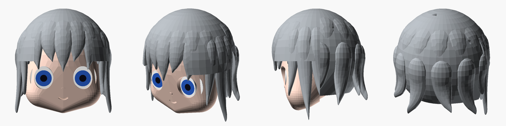

# Chibi doll head

A parametric, 3D-printable chibi doll head. It comes apart into the same pieces
as the small vinyl doll head we measured, and it is meant to fit the same
kind of body. Everything is in one file,
[`head.scad`](head.scad). You change the face and hair by editing the numbers
at the top (or with OpenSCAD's Customizer panel).



> **Status:** this is a first draft and has not been printed. The sizes come from photos
> of the original parts on 5 mm graph paper, so they are only accurate to about
> ±1 mm. Before printing everything, measure the items in
> [Measure first](#measure-first) and print `holder.stl` on its own to check the fit on the
> neck.

## Parts

| Part | Like the original | What it does |
| --- | --- | --- |
| `face` | skin-coloured face plate | Face, cheeks, chin and ears. It is open at the back, has eye holes and a flat seat behind them, and a thin tongue at the back edge |
| `eyes` | two eyes joined by a clear bridge | Eye discs. A flange sits on the seat, and a plug fills the hole |
| `iris`, `pupil` | (printed on) | Separate bodies, for multi-colour printing or to use as paint masks |
| `holder` | T-shaped piece with a socket | A plate that presses the eyes against the seat. Behind it, a box with a ball cup and a slot underneath, for the body's neck |
| `hair_front` | bangs piece | A cap with bangs and side locks. It sits over the top of the face |
| `hair_back` | back hair piece | The back of the head with flicks at the nape. The face's tongue slides into it |
| pins | — | 3 pieces of 1.75 mm filament, 7 mm long, that join `hair_front` to `hair_back` |

Assembly order: eyes into the face from behind → holder plate onto the eyes →
slide the face's tongue into `hair_back` (the holder's box ends against its
inner wall, which keeps everything clamped) → press `hair_front` on with the
three pins. Glue is optional. Without it you can swap faces and hair.

## Making it your own

All of the parameters are at the top of `head.scad`, in these groups:

- **Head shape:** the cranium ellipsoid, plus two cheek spheres and a chin
  sphere hulled together. To get a rounder, younger face, make the cheeks
  bigger and lower. To get a pointier, older face, move `chin_y` forward and
  shrink the cheeks.
- **Eyes:** `eye_x` sets the spacing, `eye_z` the height, `eye_w`/`eye_h`
  the size, and `eye_tilt` and `eye_round` the shape (below 1 flattens the
  top into a lid line). `eye_mode = "painted"` gives a face with no eye holes,
  just a shallow engraved outline to paint.
- **Face details:** the mouth arc (`mouth_smile` below 0 makes a frown) and a
  tiny nose bump.
- **Hair:** every lock is a tapering ribbon laid on the head, placed by its
  azimuth (0 = centre of the face, 90 = the doll's left ear) and by its root
  and tip heights. Bangs: `bangs`, `bang_spread`, `bang_tip_z` (a list of tip
  heights, one per lock), `bang_w`, `bang_curl`, `bang_sway`. Side locks:
  `lock_*`. Nape flicks: `back_flips`, `flip_*`. For a completely new style,
  add `lock(...)` calls to `bang_strands()`, `side_lock_strands()` or
  `back_flip_strands()`.

Render a quick check with `part="assembly"`, `"exploded"` or `"section"` (the
section is cut down the middle).

## Measure first

These are the sizes that decide whether it fits. Each one is marked `MEASURE`
in the file:

| Parameter | Estimate | How to measure it |
| --- | --- | --- |
| `ball_d` | 5.0 | diameter of the ball (or flared tip) on the body's neck peg |
| `slot_w` | 3.3 | diameter of the neck shaft just under the ball |
| `socket_z`, `socket_y` | -4.4, -1.5 | where the ball sits in the original head. Use calipers from the chin and from the face front |
| `cran_w` | 23 | width of the original face plate at the temples |
| `eye_x` | 5.6 | half the centre-to-centre spacing of the original eye holes (~11 mm) |

If you want to use the original eye insert or T-piece in a printed face,
measure those too and set `eye_w`/`eye_h`/`eye_lip`/`eye_t` to match.

## Printing

These are tiny parts with fine detail (the walls are 1.2 mm thick, the locks
taper to points), so they print best on a **resin (MSLA) printer**. The STLs
in [`stl/`](stl) are already turned to the best side for that:

| File | Qty | Material | Notes |
| --- | --- | --- | --- |
| `face.stl` | 1 | skin-tone resin | face down. Put supports on the inside only; the outside then needs no sanding |
| `eyes.stl` | 1 | white | flange down |
| `iris.stl`, `pupil.stl` | 1 | colour | optional: only for multi-colour printing |
| `holder.stl` | 1 | any | print this first to test the neck fit |
| `hair_front.stl` | 1 | hair colour | supports inside; the bang tips need light supports |
| `hair_back.stl` | 1 | hair colour | supports inside |

FDM can work with a 0.2–0.25 mm nozzle and 0.08 mm layers. If you print FDM,
set `fit = 0.25`, and consider `hair_t = 3.5`.

To regenerate the STLs:

```sh
cd doll
for p in face eyes iris pupil holder hair_front hair_back; do
  openscad -D "part=\"$p\"" -o stl/$p.stl head.scad
done
```

A full render of each hair part takes a few minutes in OpenSCAD 2021. A recent
development build with the Manifold backend is much faster.

## Compatibility notes

- The neck socket uses the same idea as the original T-piece: a ball cup in a
  box, entered through a fore-aft slot from below so the head can nod. A
  printed head should go on the original body once `ball_d`, `slot_w` and the
  socket position match.
- The printed hair and face fit **each other**. They do not snap onto the original
  vinyl face or hair, because their clip rims are too complex to copy from
  photos. If you want to mix them, we can model the original rim once we have
  caliper measurements (or a 3D scan) of it.
